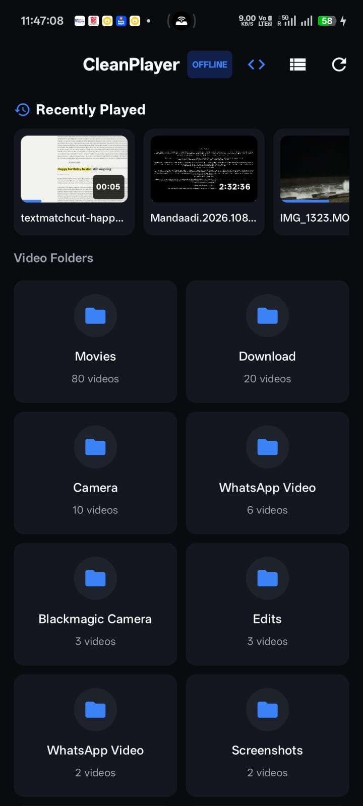
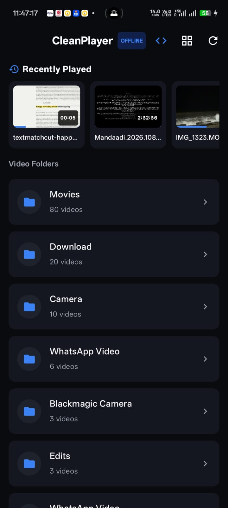
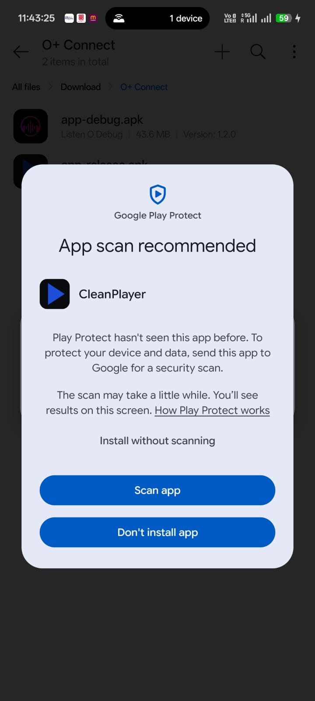

# 🎬 CleanPlayer — Offline Android Video Player

<p align="center">
  
  
  
  
  
  
</p>

<p align="center">
  <a href="https://github.com/suvo1119/CleanPlayer/releases">
    
  </a>
  <a href="https://github.com/suvo1119/CleanPlayer">
    
  </a>
  <a href="https://github.com/suvo1119">
    
  </a>
</p>

---

> 📱 **Download Direct APK**: [`images/app-release.apk`](images/app-release.apk) or grab the latest build from [GitHub Releases](https://github.com/suvo1119/CleanPlayer/releases).  
> 👤 **Developer Profile**: [https://github.com/suvo1119](https://github.com/suvo1119)  
> ⭐ **Love CleanPlayer?** Star this repository to support development! 👉 [https://github.com/suvo1119/CleanPlayer](https://github.com/suvo1119/CleanPlayer)

---

## 📖 Overview

**CleanPlayer** is a clean-room, bloat-free offline video player for Android inspired by MX Player's classic local media playback experience. Re-engineered completely from scratch with modern Android architecture (Jetpack Compose, Kotlin 2.0, AndroidX Media3 ExoPlayer), it delivers ultra-smooth video playback with **zero ads, zero tracking, and zero internet permission**.

---

## 📸 Screenshots

<p align="center">
  
  &nbsp;&nbsp;&nbsp;&nbsp;
  
  &nbsp;&nbsp;&nbsp;&nbsp;
  
</p>

<p align="center">
  <em>(Left: Grid Layout with Recent Videos &bull; Center: List Layout &bull; Right: Safe Offline Sideloading)</em>
</p>

---

## 📥 Download & Installation

1. **Download APK**: Download the standalone release APK directly from [`images/app-release.apk`](images/app-release.apk) or via [GitHub Releases](https://github.com/suvo1119/CleanPlayer/releases).
2. **Install**:
   - Open the downloaded `.apk` file on your Android device.
   - If prompted by Google Play Protect ("App scan recommended"), select **"Install without scanning"** or let Google scan it.
   - CleanPlayer contains **zero internet permissions**, ensuring 100% device privacy.

---

## 🚫 Bloat Stripped vs Original MX Player

| Feature / Bloat Item | Original MX Player | CleanPlayer |
|---|---|---|
| **Network & Internet Permission** | Present (Ad networks, online streaming, analytics) | **Completely Omitted** (Zero network permission in AndroidManifest) |
| **Prime Video / OTT Section** | Injected OTT store & subscription gate | **Removed** |
| **Fatfat / Takatak Short Videos** | Infinite vertical swipe social feed | **Removed** |
| **Games Center & Sponsored Links** | Sponsored web-views & third-party games | **Removed** |
| **In-App Advertisements** | Banner ads, interstitial ads, popup ads | **Zero Ads (Completely Clean)** |
| **User Data Collection** | Analytics & device tracking SDKs | **Zero Telemetry (100% Offline)** |

---

## ✨ Features

### 1. 🎛️ Classic Gesture Engine
* **Right-Half Vertical Swipe**: Smooth continuous media volume adjustment.
* **Left-Half Vertical Swipe**: Window brightness control without affecting system defaults.
* **Horizontal Drag**: Live timeline scrubbing with exact target timestamp preview.
* **Double-Tap**: Instant 10-second rewind (left) and fast-forward (right).
* **Screen Lock**: One-tap floating lock to prevent accidental touches while watching.

### 2. 📂 Offline Media Scanner & Library
* **Storage Scanner**: Automatically categorizes local videos using Android's `MediaStore.Video` API.
* **Smart Folders**: Cleanly groups videos into folders (Movies, Downloads, Camera, WhatsApp Video, etc.).
* **Recently Played Carousel**: Quick one-tap resume for your latest watched videos.
* **Grid / List View Toggle**: Switch effortlessly between visual grid cards and compact list rows.
* **Resume vs Start Over**: Smart prompt remembering your exact playback progress.

### 3. 🔊 Media3 Audio & Subtitle Engine
* **Multi-Track Audio Selector**: Seamlessly switch between language streams (Hindi, English, Tamil, Telugu, etc.) with human-readable language names.
* **Subtitle Switcher**: Full support for embedded tracks and external subtitle files.
* **Playback Speed Controller**: 0.5x, 0.75x, 1.0x, 1.25x, 1.5x, 2.0x playback speed steps.
* **Aspect Ratio & Orientation**: Fit, Fill, Stretch, and one-tap screen orientation lock.

### 4. 🌙 AMOLED Pure Dark UI
* Engineered with deep `#0A0B0E` black tones tailored for battery savings on OLED and AMOLED screens.

---

## 🛠 Tech Stack

- **Target OS**: Android (minSdk 24, targetSdk 35)
- **Language**: Kotlin 2.0
- **UI Framework**: Jetpack Compose (Material 3)
- **Media Engine**: AndroidX Media3 ExoPlayer 1.5.0
- **Image/Thumbnail Loading**: Coil 2.7.0 (Video Frame Decoder)
- **Navigation**: Jetpack Navigation Compose
- **Build System**: Gradle 8.7 with Kotlin DSL (`build.gradle.kts`)

---

## 🚀 Building from Source

### Using Android Studio
1. Clone the repository:
   ```bash
   git clone https://github.com/suvo1119/CleanPlayer.git
   ```
2. Open Android Studio.
3. Select **Open** and choose the `CleanPlayer` folder.
4. Let Gradle sync and press **Run** (`Shift + F10`) on your device/emulator.

### Using Command Line
```bash
# Debug APK
./gradlew assembleDebug

# Release APK
./gradlew assembleRelease
```
The output APK is generated at:
`app/build/outputs/apk/release/app-release-unsigned.apk` (or configured keystore output).

---

## 👨‍💻 Developer & Support

Developed with ❤️ by **[suvo1119](https://github.com/suvo1119)**.

- **GitHub Profile**: [https://github.com/suvo1119](https://github.com/suvo1119)
- **Repository**: [https://github.com/suvo1119/CleanPlayer](https://github.com/suvo1119/CleanPlayer)
- ⭐ **Show your support**: If you enjoy using CleanPlayer, give the repository a star on GitHub!

---

## 📄 License

This project is licensed under the [MIT License](LICENSE).
